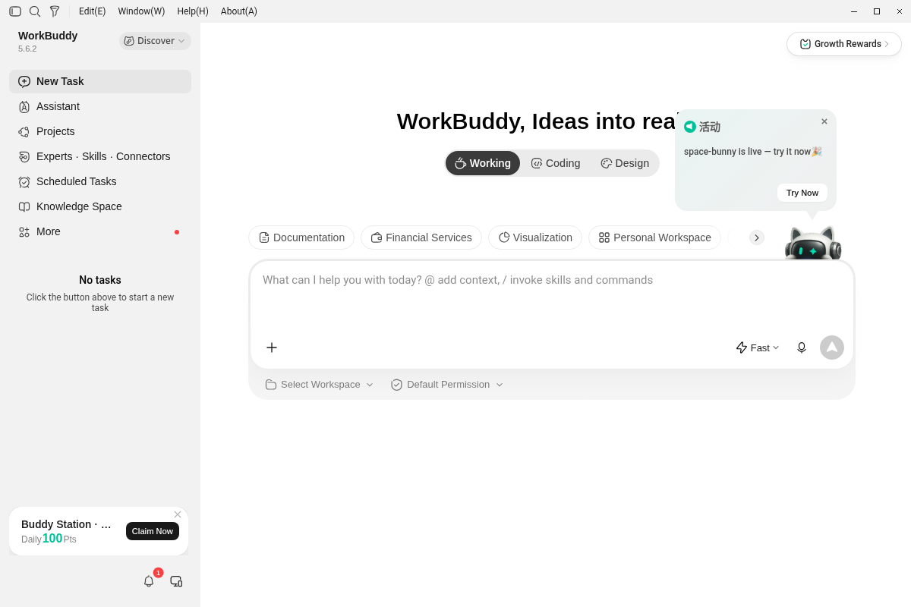
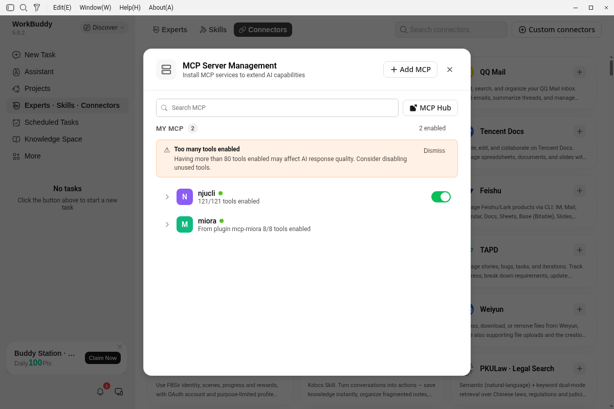
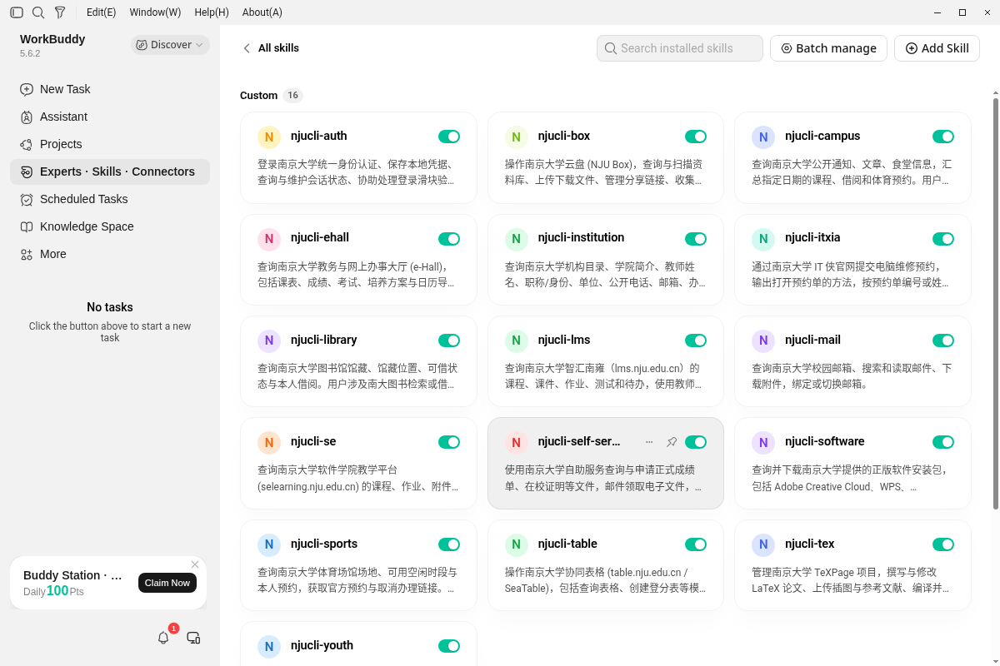
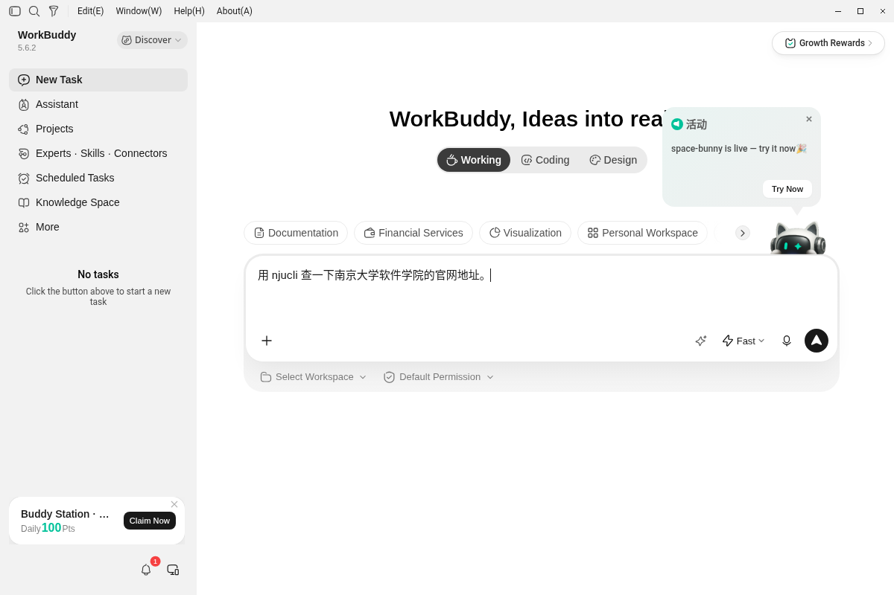
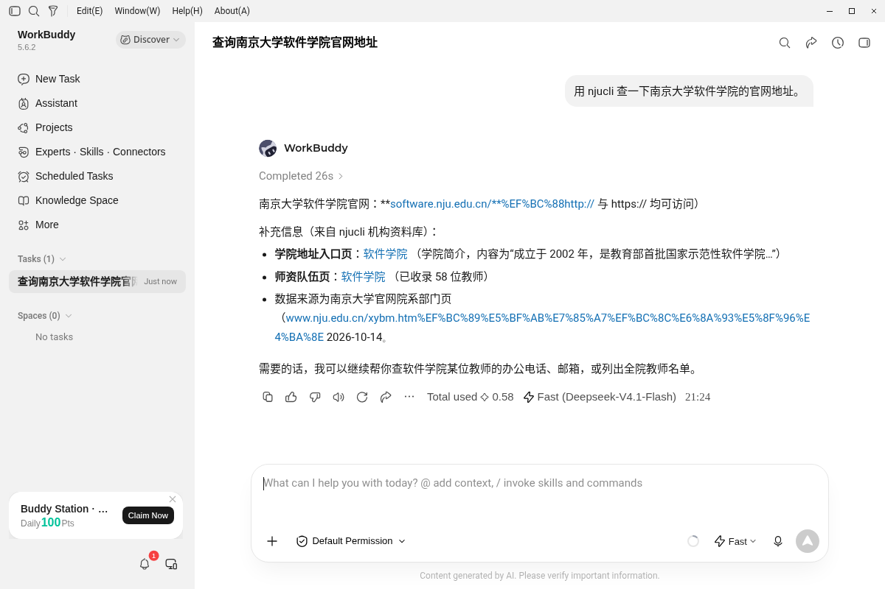

# 在 WorkBuddy 中使用 NjuCLI

WorkBuddy 是腾讯推出的 AI 办公工作台桌面客户端，支持 MCP（Model Context Protocol）与 Skills 扩展。免费版提供对话功能，实测默认模型为 Fast（Deepseek-V4.1-Flash）。本文介绍如何在 WorkBuddy 中配置 NjuCLI 的 MCP 只读工具与 Skills。

## 前提条件

- 操作系统：Linux、macOS 或 Windows（本文步骤已在 WorkBuddy 5.6.2 英文版 Linux deb 环境完成验证）
- 基础依赖：Node.js 20+、Git、curl、Bash
- WorkBuddy 客户端正常运行



图 1：WorkBuddy 主界面的左侧入口用于打开 Skills 与 MCP 配置。

## 1. 安装 NjuCLI

在运行 WorkBuddy 的本地计算机上打开终端，执行以下命令，一次安装 NjuCLI 并将配套 Skills 注册到 WorkBuddy：

```bash
curl -fsSL https://raw.githubusercontent.com/MarcWebber/njucli/main/scripts/install.sh | NJUCLI_SKILLS_DIR=~/.workbuddy/skills bash
```

环境变量放在 `bash` 前面，指定 Skills 的注册目录。后续通过以下命令一起更新：

```bash
njucli upgrade
```

WorkBuddy 在本机直接调用命令，因此 `njucli` 必须存在于运行 WorkBuddy 的系统的 `PATH` 环境变量中。

## 2. 配置 MCP

### 编写配置文件

WorkBuddy 支持用户级与项目级两处 MCP 配置文件：

- 用户级：`~/.workbuddy/mcp.json`
- 项目级：`<项目目录>/.workbuddy/mcp.json`

在对应路径创建或编辑 `mcp.json`，写入以下内容：

```json
{
  "mcpServers": {
    "njucli": {
      "command": "njucli",
      "args": ["mcp"]
    }
  }
}
```

若出现找不到命令的情况（常见于 Windows 环境），需将 `"command"` 的值改为 `njucli` 可执行文件的绝对路径。

### 重启与信任确认

保存 `mcp.json` 后，必须完全退出 WorkBuddy 进程再重新启动客户端。

首次建立连接时，WorkBuddy 会弹出信任提示：

> This MCP server requires your trust before first connection

点击 **Trust** 继续。

### 在界面中确认状态

在 WorkBuddy 5.6.2 英文界面中按以下路径检查：

1. 点击左侧栏 **Experts · Skills · Connectors**。
2. 点击顶部 **Connectors** 标签。
3. 点击右上角 **Custom connectors**，打开 **MCP Server Management** 弹窗。

正常状态下 `njucli` 前显示绿点，并标注已启用的工具数量。当前完整工具清单为 136 个，具体数量随安装版本变化。



图 2：在 MCP 管理窗口检查 njucli 的连接状态与工具列表；工具数量随安装版本变化。

### 工具数量建议

弹窗内会显示 **Too many tools enabled** 提示（启用超过 80 个工具可能影响模型回答质量）。建议展开 `njucli`，关闭当前不需要的工具，仅保留常用功能。

其他版本的菜单名称和位置可能存在差异（部分官方文档中表述为“插件 → MCP”），请以实际界面为准。

## 3. 启用 Skills

第 1 步已将配套 Skills 注册到 `~/.workbuddy/skills`，它们提供各业务的使用说明，统一调用 `njucli`。注册路径指向同一个安装包，执行 `njucli upgrade` 时一起更新。

安装完成后，进入 **Experts · Skills · Connectors** → **Skills** → **Installed** → **All skills**，可在 **Custom** 分组中看到安装的 Skill，每个 Skill 均配有独立开关。



图 3：在 Custom 分组中检查已注册的 njucli Skills，并启用需要的业务说明。

## 4. 试用

在 WorkBuddy 中点击新建任务（New Task），在输入框中输入查询请求：

```text
用 njucli 查一下南京大学软件学院的官网地址。
```



图 4：在新任务中输入具体查询需求，开始调用已安装的 NjuCLI。

WorkBuddy 会自动调用 `njucli-institution`，返回软件学院官网 `software.nju.edu.cn`，并提供学院简介入口、师资队伍页及数据来源，调用过程无需额外授权确认。



图 5：回答展示查询结果和来源，可据此核对本次任务是否完成。

## 5. 限制与注意事项

- **只读设计**：MCP 服务当前提供 136 个只读工具，不执行任何写操作。
- **写操作执行**：提交、取消、预约等写操作由 Skill 通过 CLI 命令完成，且仅在用户提出明确要求时才会执行。
- **身份认证**：查询课表、成绩、邮件、云盘等需要登录的服务前，必须先在运行 WorkBuddy 的计算机终端执行 `njucli auth login` 保存统一认证凭据。
- **使用许可**：NjuCLI 采用个人使用许可证，机构或组织批量使用须另获书面授权。

## 6. 常见问题

### 提示找不到命令
WorkBuddy 未在系统环境变量中找到 `njucli`。请检查系统的 `PATH` 设置，或在 `mcp.json` 中把 `"command"` 改为绝对路径。

### 界面未出现 njucli 或无法连接

1. 检查 `~/.workbuddy/mcp.json` 的 JSON 语法是否有效。
2. 确认是否已彻底关闭 WorkBuddy 进程并重新打开。
3. 检查首次启动时是否弹出了信任提示，若被忽略需重新触发并点击 Trust。

### Skills 列表中看不到已安装的扩展

1. 检查 `~/.workbuddy/skills` 目录下是否存在对应文件。
2. 确认第 1 步的 `NJUCLI_SKILLS_DIR` 设置正确，注册路径指向已安装的 NjuCLI。
3. 重启 WorkBuddy 客户端刷新缓存。

---

相关文档：

- [AI 客户端接入](ai-plugin.md)
- [README](../README.md#安装)
